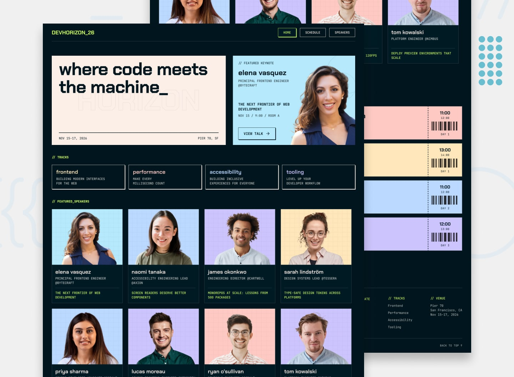

# Frontend Mentor - Tech Conference Site

A responsive, multi-page conference website for **DevHorizon 2026**. Visitors can explore the event, browse its speakers and talk programme, save sessions to a personal schedule, and export sessions as calendar files. The app is built with Astro, TypeScript, React islands, and Tailwind CSS, and includes Progressive Web App support.

## Table of contents

- [Overview](#overview)
  - [The challenge](#the-challenge)
  - [Screenshot](#screenshot)
  - [Links](#links)
  - [Application features](#application-features)
  - [Schedule and saved sessions](#schedule-and-saved-sessions)
  - [Data model](#data-model)
  - [Accessibility](#accessibility)
  - [Progressive Web App](#progressive-web-app)
- [Getting started](#getting-started)
- [Project structure](#project-structure)
- [My process](#my-process)
  - [Built with](#built-with)
  - [How the application works](#how-the-application-works)
  - [What I learned](#what-i-learned)
  - [Continued development](#continued-development)
  - [Useful resources](#useful-resources)
  - [AI collaboration](#ai-collaboration)
- [Author](#author)
- [Acknowledgments](#acknowledgments)

## Overview

### The challenge

This project is a complete conference information and planning site based on the [Frontend Mentor Tech Conference Site challenge](https://www.frontendmentor.io/challenges/tech-conference-site). It brings together the main information attendees need: what the event is about, who is speaking, what sessions are happening, and how to keep track of sessions they want to attend.

The interface is designed to adapt from small mobile screens to larger desktop screens. Shared conference information is presented consistently across the home, schedule, and speakers pages.

### Screenshot



### Links

- Frontend Mentor solution: [Tech Conference Site solution](https://www.frontendmentor.io/solutions/tech-conference-app-with-pwa-support-astro-typescript-react-dEomX2O7oz)
- Live site: [tech-conference-ashen.vercel.app](https://tech-conference-ashen.vercel.app/)

### Application features

#### Home page

The home page introduces the event and directs visitors to the detailed programme:

- A hero panel presents the conference tagline, date range, and venue.
- A featured keynote panel highlights Elena Vasquez, her keynote, and its session time and room. Its **View talk** link opens the schedule with that talk expanded.
- A tracks section introduces Frontend, Performance, Accessibility, and Tooling. Each track links to the schedule filtered to that track.
- A featured-speakers section shows speakers flagged as featured in the data and links to the full speaker directory.
- Schedule highlights show talks flagged as highlighted in the conference data. The talk cards can be expanded to reveal descriptions and room locations.
- A **View full schedule** call to action opens the complete programme.

#### Schedule page

The schedule page displays the talks as a list of cards. Each card includes its track, talk title, speaker and company, start and end time, day, and an add-to-schedule control.

- **Day filters:** Choose one conference day at a time. The default is Day 1 when no day is specified in the URL.
- **Track filter:** Choose one track at a time. Track names are Frontend, Performance, Accessibility (labelled **a11y** in the filter), and Tooling. The Keynote track is not offered as a filter.
- **My Schedule filter:** Show only the sessions saved in this browser. It can be used together with the selected day and track.
- **Reset filters:** Clear the query parameters and return to the default Day 1 view.
- **Clear my schedule:** Remove all saved session IDs from the local saved schedule.
- **Talk details:** Expand a card to read the full description and room. Only the talk selected through the `talk` URL parameter opens automatically; the control updates the URL when toggled.
- **Empty state:** If the selected day, track, and saved-only combination has no matching talks, a status message suggests changing or resetting filters.
- **Calendar exports:** Download every conference talk or only saved talks as an `.ics` calendar file. If there are no saved talks, the saved-schedule action displays a short message instead of downloading an empty file.

Day, track, saved-only, and expanded-talk state are represented in the URL query string. This makes a filtered or expanded schedule view linkable and allows browser Back and Forward navigation to restore previous views.

#### Speakers page

The speakers page presents all speakers in a responsive card grid. Cards show the speaker's portrait, name, role, company, and talk title. Activating a speaker name opens a dialog with:

- A larger speaker portrait, role, and company.
- The speaker's full biography.
- Their associated talk, including its track, time, and a control to save or remove it from **My Schedule**.
- Dialog close controls, including the close button, backdrop interaction, and Escape-key support provided by the dialog component.

The home page reuses the same speaker cards for the featured subset.

#### Shared site interface

- A shared header links to Home, Schedule, and Speakers. The active desktop page is indicated in the navigation.
- On narrow screens, navigation is provided by a slide-in menu drawer with open and close controls.
- A shared footer provides navigation links, track links, venue details, the event dates, copyright, and a smooth **Back to top** control.
- Page titles and descriptions are set per route for document metadata.

### Schedule and saved sessions

Saved sessions are identified by talk IDs and managed through a Nanostores persistent store. The store serializes the list to browser storage, so a visitor's selections remain available after reloading or reopening the site in the same browser. No account or server-side profile is required.

The star control is available on schedule cards and inside a speaker's talk dialog. It exposes its action and pressed state through accessible button attributes. The **My Schedule** filter reads the same saved IDs, and the saved-calendar export uses those IDs to select which events to include.

Calendar exports use the conference start date plus each talk's day number to determine its date. Talk title, description, room, start time, and end time are included in the generated calendar events. Talks outside the configured conference date range are skipped.

### Data model

Conference content is maintained in [src/lib/data/data.json](./src/lib/data/data.json). The JSON contains four top-level properties:

| Property | Purpose |
| --- | --- |
| `conference` | Event name, brand code, tagline, start and end dates, and venue location. |
| `tracks` | Track IDs, names, descriptions, and colors. |
| `speakers` | Speaker IDs, names, roles, companies, avatar paths, biographies, and featured flags. |
| `talks` | Talk IDs, titles, speaker and track references, day, start and end times, room, description, and highlighted flag. |

Talks reference speakers and tracks by ID. The pages resolve those references at render time to show names, descriptions, and track colors. The separate [src/lib/data/tracks.ts](./src/lib/data/tracks.ts) provides the labels, URL values, and descriptions used by the home page and footer track links.

The `Keynote` track is used for the featured keynote content. It is intentionally omitted from the general track links and schedule track filters. The `featured` speaker flag controls which speaker cards appear on the home page; the `highlighted` talk flag controls which talks appear in the home page schedule highlights.

When adding or editing content, keep IDs unique and ensure each talk's `speakerId` and `trackId` point to existing records. Use day numbers that fall within the configured event dates and times in `H:MM` 24-hour format.

### Accessibility

Accessibility considerations implemented in the interface include:

- Semantic page landmarks, headings, navigation, lists, and buttons.
- Keyboard-operable links and controls, with visible focus treatments on interactive elements.
- `aria-pressed` state on schedule filter buttons and saved-talk buttons.
- `aria-expanded` and `aria-controls` relationships for talk detail disclosures.
- `aria-hidden` state on collapsed talk-detail panels, updated with the expanded state.
- A polite live status for the schedule's no-results message.
- Accessible names for icon-only controls, including mobile menu actions and saved-talk buttons.
- A dialog primitive for speaker details, providing standard dialog interaction and dismissal behavior.
- Decorative images and icons use empty alternative text where appropriate.

### Progressive Web App

The app registers a service worker through `@vite-pwa/astro` and requests immediate registration with automatic updates. A web app manifest configures the app name, theme and background colors, standalone display mode, start URL, and install icons. Workbox is configured with a navigation fallback and precaches matching JavaScript, CSS, HTML, SVG, PNG, WebP, and font files generated for the build.

The PWA setup allows supported browsers to offer an installable app experience and serves cached application assets when available. Actual offline behavior depends on the browser's service-worker support and which assets have already been cached.

## Getting started

### Requirements

- Node.js **22.12.0 or newer** (as specified by the project).
- pnpm, used to install dependencies from the included lockfile.

### Install dependencies

```sh
pnpm install
```

### Run the development server

```sh
pnpm dev
```

Astro starts the local development server and prints its URL in the terminal.

### Build and preview

```sh
pnpm build
pnpm preview
```

The production build is written to `dist/`. The preview command serves that build locally.

## Project structure

```text
public/                       Static images, icons, and web manifest
  images/                     Speaker portraits
  screenshot.jpg              README project screenshot
src/
  assets/                     Bundled SVG patterns and local font files
  components/
    client/                   Interactive React islands
    footer/                   Shared footer sections
    header/                   Shared desktop/mobile navigation
    home/                     Home page sections
    schedule/                 Talk cards, filters, and calendar actions
    speakers-page/            Speaker directory and cards
    svgs/                     Reusable SVG components
    ui/                       Shared UI components
  layouts/                    Shared page layout, metadata, and containers
  lib/
    data/                     Conference JSON and navigation/track links
    types/                    TypeScript data and component types
  pages/                      Astro route entry points
  stores/                     Persistent My Schedule state
  styles/                     Global Tailwind theme and styles
  utils/                      Date formatting and calendar generation
astro.config.mjs              Astro, React, Tailwind, fonts, and PWA setup
package.json                  Scripts and dependencies
pnpm-lock.yaml                Locked dependency versions
```

## My process

### Built with

- [Astro](https://astro.build/) for page routing, layouts, and server-rendered components.
- [TypeScript](https://www.typescriptlang.org/) for typed application code and content interfaces.
- [React](https://react.dev/) for interactive client-side components.
- [Tailwind CSS](https://tailwindcss.com/) for responsive utility styling and the project design tokens.
- [Nanostores](https://nanostores.github.io/nanostores/) and its persistent adapter for the saved-talk state.
- [Base UI](https://base-ui.com/) for accessible dialog and drawer primitives.
- [Lucide](https://lucide.dev/) icons for interface controls.
- [ics](https://github.com/adamgibbons/ics) for generating downloadable calendar files.
- [Vite PWA](https://vite-pwa-org.netlify.app/) for service-worker registration, manifest support, and Workbox configuration.
- Local Chakra Petch and JetBrains Mono fonts.
- Responsive layouts using CSS Grid, Flexbox, and mobile-first breakpoints.

### How the application works

Astro renders the page structure and the largely static conference content. React is used where the interface needs client-side state or accessible overlay behavior: mobile navigation, saved-talk controls, and speaker dialogs. The schedule filter and talk disclosure behavior use small browser-side scripts.

Schedule filters and the selected talk are encoded in query parameters. The schedule page reads those parameters, compares them with data attributes on each rendered talk card, and hides cards that do not match. Filter actions update browser history and dispatch an event so the list can be refreshed without a full page reload.

### What I learned

This project brought together several patterns that work well for a content-heavy event site:

- Keep structured content separate from presentation. Stable speaker, talk, and track IDs make it straightforward to connect related records.
- Use Astro for pages that are mostly content, then hydrate React components only where browser interaction is needed.
- Treat the URL as shareable interface state for filters and open talk details. This also makes browser history useful instead of leaving filter changes invisible to navigation.
- Keep shared saved-session state in one persistent store so cards, filters, and exports all use the same source of truth.
- Generate calendar events from conference dates and talk times rather than maintaining separate downloadable files.
- Establish a small theme with named colors, type presets, and button variants so the same design language can be applied throughout the site.

### Continued development

Possible next improvements include:

- Allow selecting multiple tracks at once, if the schedule experience should support combined track selection.
- Add dedicated automated checks for filter combinations, persistence, calendar export dates, and dialog keyboard interactions.
- Improve PWA feedback by surfacing service-worker registration and offline-ready state to visitors.
- Review screen-reader announcements for saved-session changes and filter result counts, in addition to the existing no-results status.
- Make all event-specific display text, including venue and keynote presentation details, derive from the conference data rather than fixed component text.
- Add an event timezone field so calendar exports can represent the venue's local time explicitly.

### Useful resources

- [Astro documentation](https://docs.astro.build/) - Guides for Astro pages, components, layouts, and integrations.
- [Astro routing](https://docs.astro.build/en/guides/routing/) - Reference for the file-based routes used by the app.
- [Astro framework components](https://docs.astro.build/en/guides/framework-components/) - Explains how React components can be included in Astro pages.
- [Tailwind CSS documentation](https://tailwindcss.com/docs) - Utilities and configuration reference for responsive styling.
- [Nanostores documentation](https://nanostores.github.io/nanostores/) - Small reactive stores used for saved sessions.
- [Vite PWA documentation](https://vite-pwa-org.netlify.app/) - Service-worker and web app manifest configuration.
- [MDN: ARIA](https://developer.mozilla.org/en-US/docs/Web/Accessibility/ARIA) - Reference for the accessibility attributes used by interactive controls.

### AI collaboration

AI assistance was used to prepare this README from the project source. The implementation details were checked against the pages, components, data, and configuration in the repository. This note describes the documentation work and does not claim that AI was used for the original application implementation.

## Author

- Frontend Mentor solution: [Tech Conference Site](https://www.frontendmentor.io/solutions/tech-conference-app-with-pwa-support-astro-typescript-react-dEomX2O7oz)

Personal profile links are omitted because no author profile details were provided.

## Acknowledgments

- [Frontend Mentor](https://www.frontendmentor.io/) for the Tech Conference Site challenge and project brief.
- The maintainers of Astro, React, Tailwind CSS, Nanostores, Base UI, Lucide, ics, and Vite PWA for the tools and documentation used by the project.
